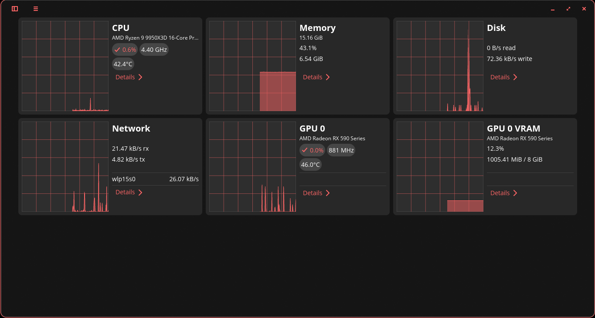
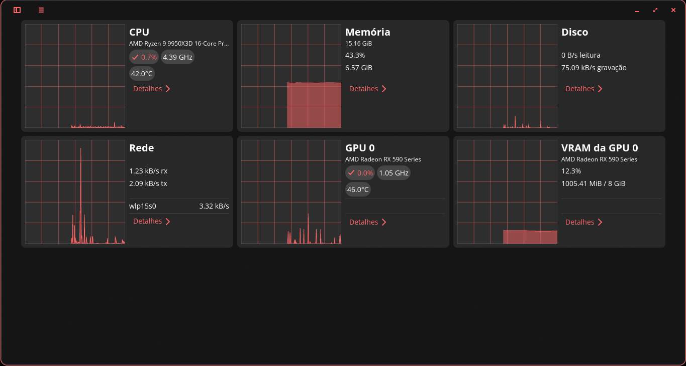

# COSMIC Monitor (Graphs)

A graphs-only dashboard for [COSMIC System Monitor](https://github.com/pop-os/cosmic-monitor), with a separate user installation and a safe update workflow. Linux / COSMIC; unofficial community modification, distributed under GPL-3.0-only.

[Português](#português)



*Graphs-only dashboard. Captured from the running application on COSMIC; visible cards depend on detected hardware.*

## Install a prebuilt Debian package (recommended)

Download the **amd64 `.deb`** from the [latest release](https://github.com/Arthurregiani/cosmic-monitor-graphs/releases/latest). It targets **Pop!_OS 24.04 with COSMIC** (Ubuntu 24.04 library baseline). No Rust or compilation is required.

```sh
sudo apt install ./cosmic-monitor-graphs_1.1.0_amd64.deb
```

Open **COSMIC Monitor (Graphs)** from the app launcher, or run `/usr/bin/cosmic-monitor-graphs`. To upgrade, install the newer `.deb` using APT in the same way. To remove it, use `sudo apt remove cosmic-monitor-graphs`. Package updates are manual; this project does not add an APT repository. SHA256 checksums and complete corresponding build sources, including vendored Cargo dependencies, are attached to the release. Other architectures and distributions are not validated by this release.

### Migrating from the manual user installation

A user desktop entry takes precedence over the packaged desktop entry. After installing the `.deb`, move only `~/.local/share/applications/org.local.CosmicMonitorGraphs.desktop` (or the equivalent under your custom `XDG_DATA_HOME`) out of the applications folder, and rename `~/.local/bin/cosmic-monitor-graphs` if it exists. Keep the old files as a backup. The previous binaries and saved preferences can remain; the package uses the same configuration ID. Restart the application from the system launcher or `/usr/bin/cosmic-monitor-graphs`.

The package installs only `/usr/bin/cosmic-monitor-graphs`, its separate desktop entry, icons and documentation. It ships no maintainer scripts and does not alter the distribution monitor or user home directories.

## Build from source (optional)

Requires Python 3.10+, Git, pkg-config, Rust/Cargo **1.95 or later**, and native COSMIC build dependencies. On Pop!_OS/Ubuntu:

```sh
sudo apt install git python3 pkg-config libxkbcommon-dev libwayland-dev libudev-dev libfontconfig1-dev libegl1-mesa-dev
rustc --version
cargo --version
git clone https://github.com/Arthurregiani/cosmic-monitor-graphs.git
cd cosmic-monitor-graphs
python3 monitor.py install
```

Install a current Rust toolchain from [rustup.rs](https://rustup.rs/) if your distribution's Rust is too old. Run the installer **without sudo**. Compilation downloads the official upstream source and its Cargo dependencies; the first build can take a while.

Open **COSMIC Monitor (Graphs)** in the application launcher, or run:

```sh
~/.local/bin/cosmic-monitor-graphs
```

The dashboard starts in graphs-only mode for new profiles. Use the application menu to switch between graphs and the complete dashboard. CPU, memory, disk, network and detected GPU/VRAM cards remain available, as do the detailed pages. Settings use `org.local.CosmicMonitorGraphs`, separate from the system app. Existing users keep their saved choice.

## Updates and recovery

```sh
git pull --ff-only
python3 monitor.py install       # Build the revision tested by this overlay
python3 monitor.py check --latest # Test today's upstream without installing it
python3 monitor.py install --latest # Optional: build and install today's upstream
python3 monitor.py status
python3 monitor.py rollback      # Switch to the previously installed binary
```

Close and reopen the application after installation or rollback. Rollback switches binaries; settings are retained and are not versioned.

The overlay is a small reviewable patch in `patches/graphs-only.patch`. `upstream.json` pins the supported upstream commit; upstream's `Cargo.lock` is respected with `--locked`. New versions are prepared in `.build/`, and installed only after patch application and compilation succeed. A conflict or build failure exits with an error and keeps the installed binary. There is no automatic system update hook or background updater.

Installed executables live in `${XDG_DATA_HOME:-~/.local/share}/cosmic-monitor-graphs/releases/`, selected through an atomic `current` symlink. The launcher lives in `~/.local/bin/`; neither path depends on where you cloned this repository. Moving or deleting the checkout does not break the installed application. Distribution updates to `/usr/bin/cosmic-monitor` do not overwrite this installation. Changes to system libraries can still require rebuilding.

GitHub Actions builds both the pinned version and current upstream on pushes, pull requests, manual runs and every Monday. Enable Actions notifications in your GitHub account if you maintain a fork. A passing build cannot guarantee compatibility with every future upstream change or runtime behavior on every GPU. When upstream changes the affected code, maintainers must review and adapt the patch, test it on COSMIC, and update the pin.

To remove the installation, delete only these project-owned paths: `~/.local/bin/cosmic-monitor-graphs`, `$XDG_DATA_HOME/applications/org.local.CosmicMonitorGraphs.desktop`, and `$XDG_DATA_HOME/cosmic-monitor-graphs/` (default data home: `~/.local/share`). The installer preserves a pre-existing launcher entry as `org.local.CosmicMonitorGraphs.desktop.backup` in the applications folder; restore it if wanted. Settings remain under the COSMIC configuration directory.

## Debian packaging

On an amd64 Ubuntu/Pop!_OS 24.04 build host, install the source-build dependencies plus `dpkg-dev`, `binutils`, `fakeroot`, `desktop-file-utils` and `xz-utils`, then run:

```sh
python3 packaging/build_deb.py
python3 packaging/test_deb.py dist/cosmic-monitor-graphs_1.1.0_amd64.deb
python3 packaging/source_archive.py .build/source-6b160c0356280948943c1ada822d6b916c7488d9
```

The package builder remaps personal build paths, strips symbols, computes ELF dependencies with `dpkg-shlibdeps`, includes dynamically loaded runtime libraries and enforces package permissions even with `umask 077`. The test installs/removes in a temporary dpkg root and asks APT to simulate dependency resolution; it does not install on the host. Pushing a matching `vVERSION` tag runs the Ubuntu 24.04 release workflow and publishes the `.deb`, complete sources and SHA256 sums only after these checks succeed.

## Development

```sh
python3 -m unittest discover -s tests -v
python3 monitor.py check
```

Tests exercise source-folder relocation, paths with spaces, repeated installation, binary rollback, shortcut backup, and patch/build failure recovery. CI performs real release builds. Runtime verification requires a graphical COSMIC session.

To port the overlay, prepare a clean checkout of the desired upstream revision, apply and resolve the patch there, inspect **all** changes, then regenerate it using `git diff HEAD -- src/main.rs src/config.rs src/menu.rs i18n/en/cosmic_monitor.ftl i18n/pt-BR/cosmic_monitor.ftl`. Update `upstream.json`, run both CI builds, and validate the UI before publishing. Never point the installer at a checkout containing private changes.

## Português

Esta modificação adiciona o modo **Exibir apenas gráficos** ao Monitor do Sistema COSMIC. Os cartões ocupam a largura da janela, sem as listas de aplicativos/processos e sem o processo de maior consumo em cada cartão. O menu permite restaurar o painel completo, e a escolha é salva.



*Captura real no COSMIC, com o modo de gráficos ativado. Os cartões disponíveis dependem do hardware detectado.*

Para instalar **sem compilar**, baixe o `.deb` em [Releases](https://github.com/Arthurregiani/cosmic-monitor-graphs/releases/latest) e execute `sudo apt install ./cosmic-monitor-graphs_1.1.0_amd64.deb`. O pacote é para amd64 com Pop!_OS 24.04/COSMIC. Para remover, use `sudo apt remove cosmic-monitor-graphs`. Se você já usava a instalação manual, veja a seção de migração acima.

A instalação é independente: não substitui o monitor do Pop!_OS e continua funcionando se você mover a pasta do projeto. Instale as dependências e execute os comandos da seção **Build from source** (apenas se preferir compilar). Abra **Monitor COSMIC (Gráficos)** no menu de aplicativos.

Para atualizar a versão testada, use `git pull --ff-only` e `python3 monitor.py install`. Para experimentar o código oficial mais recente, use primeiro `python3 monitor.py check --latest` e depois `python3 monitor.py install --latest`. Se o patch ou a compilação falhar, o executável instalado é preservado. Para voltar à instalação anterior, execute `python3 monitor.py rollback` e reabra o aplicativo.

O GitHub verifica semanalmente se a modificação ainda compila com o monitor oficial. Essa verificação detecta quebras; mudanças futuras podem exigir manutenção do patch. Atualizações de bibliotecas do sistema também podem exigir recompilação.

## Credits and license

COSMIC System Monitor and its original code are by Jeremy Soller, System76 and the upstream contributors. Graphs-only modification and distribution tooling: Arthur Regiani. This project is not an official System76 product. The patch and tooling are GPL-3.0-only; see [LICENSE](LICENSE). The installer obtains the full upstream source from its public repository; that source and its license remain available in `.build/` after compilation.
